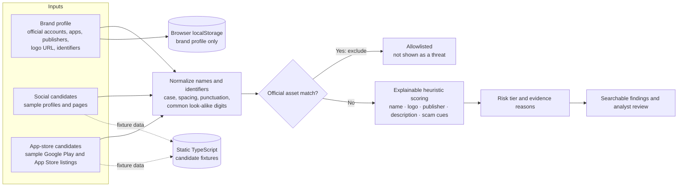

# BrandShield AI prototype architecture

## What is implemented

- A user-editable brand profile with the brand name, optional logo URL, identifiers, official social handles, and official mobile applications.
- Social-account allowlisting by normalized account handle or page URL.
- App allowlisting by store plus package ID, with exact app name and publisher as a fallback.
- Candidate scoring from name resemblance, claimed logo use, app publisher mismatch, brand references in descriptions, and scam indicators.
- A findings queue with risk filters, search, platform/source filters, and a per-finding explanation.
- A local-only sample source status. No external service is represented as connected.

## Detection notes and limitations

The prototype normalizes case, separators, and common look-alike digits/characters, then compares names using edit distance. Matching names alone receive a lower score than names corroborated by other signals. Findings are illustrative leads and require analyst review; this heuristic is not a production classifier and does not fetch profiles, logos, descriptions, or app-store listings.

The browser stores only the saved brand profile in `localStorage`. Candidate fixtures are static in `src/detection.ts`. Production deployment would need authorized source integrations, backend storage, asset ingestion, image similarity, durable audit history, and a tuned model/ruleset.
